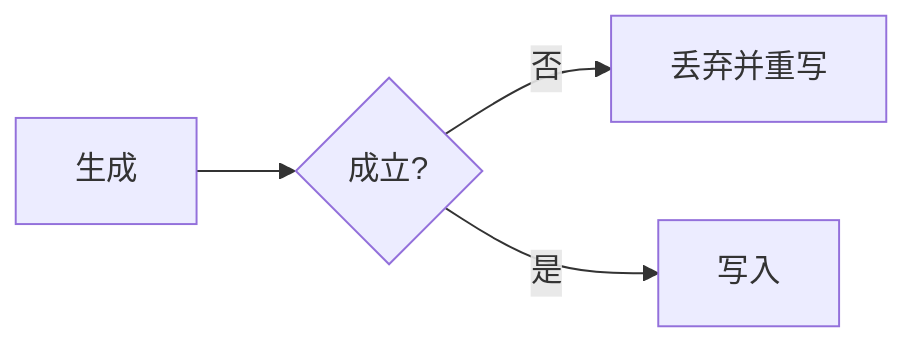

# 图怎么用

文档要能在老版本 markdown、旧 mermaid、公司 wiki 里打开。数量对比用表格加 `█`，行为变化用 `graph`。不要另做 HTML 或 Canvas，也不要在对话里再画一遍。

图或条形表前面用一句话给出结论和关键数字。这句话不要把每个点再念一遍。

同一份文档里，不要又画条形又贴一张同数据的表。结论句可以带上关键的那一个对比。下面的数字是编的，只看格式，不要抄进真实文档。

## 三条硬规则

1. 只用 `graph`，不用 `flowchart`。`flowchart` 在 mermaid 8.4 及以下直接报错。
2. 图内每行顶格。行首空格会被某些编辑器改成 `&#160;`，整张图变成源码。
3. 标签里只用中文、英文、数字、空格，以及 `? ! . , : - + = / %`。不用引号、括号、全角标点、`①` `≥` `×`、`;` `~` `@`、`<br/>`、`style`、`subgraph`。

一个节点只说一件事，不超过 20 字。换行、补充、公式放到图下面的列表。判断写成菱形，分支写在边上：`B -->|是|`、`B -->|否|`。



`sequenceDiagram`、`classDiagram`、`gantt` 从 mermaid 7.1 起可用。汇报里一般用不到。不用 `pie`、`mindmap`、`timeline`、`quadrantChart`、`xychart-beta`。

## 选哪种

| 要表达的 | 用 | 不要 |
|---|---|---|
| 同一单位的改前 / 改后，指标不超过 4 个 | 每个指标一张 `█` 表 | `xychart-beta`；再贴一张同数据的表 |
| 调用链、分支、两条以上独立回滚开关 | 顶格 `graph` | `flowchart`、`subgraph`、`style`；把同一条链路写成 1.2.3 |
| 测试通过 / 失败 / 报错 | 三行表，外加一句和基线比的结论 | 饼图或条形。失败条数通常小很多，画出来会被压没 |
| 单位不同、只有一个数、指标超过 4 个、样本少于 10 | 一句话或短表 | 单柱、趋势图 |
| 文件改了什么、用例在查什么、没变的范围 | 短表 | 流程图 |
| 象限、时间线、分层要点 | 两行两列表、时间/事件表、嵌套列表 | `quadrantChart`、`timeline`、`mindmap` |

没有实测数字就不画数量条形，也不要写「示意」。

## 前后对比

一个指标一张表。行只有「改前」「改后」。

- 格数 = (数值 − 起算值) ÷ 每格，四舍五入。数值等于起算值时图示写「无」，不要画 1 格假装有量。
- 起算值取这张表里的最小值，再往下取整到整齐刻度。全表都挤在高位时不要从 0 起算，否则长短看不出差别。跨度从 0 到几十的百分比可以从 0 起算。
- 每格大约取 (最大值 − 起算值) ÷ 15。最长一条 15 到 25 格。最小值如果不是 0，至少留 3 格。
- 表前面一行必须写「条长从 X 起算，每格 Y」。自检脚本靠这行核对格数。

**超时次数（50 个样例，条长从 0 起算，每格 1）**

| | 超时次数 | 图示 |
|---|---|---|
| 改前 | 16 | ████████████████ |
| 改后 | 1 | █ |

多个指标上下各放一张。超过 4 个指标改用没有条形的表。

## 流程图

行为变化用表格说不清时才画。不超过 8 个节点。节点 id 用英文，标签用中文或函数名。只有分支才写边上的字。两条边分别写，不用 `A & B --> C`。

回滚只有一个开关或一条 revert 时，写那一句，不画图。文件少于 5 个时，一句话列出路径，不画图。

图下面只补图上没有的事实，用列表，不要把节点文字再抄一遍。

## 测试构成

用表，不用条形：

| | 条数 |
|---|---|
| 通过 | 953 |
| 报错 | 207 |
| 失败 | 14 |

表下一句：失败集和改动前是否相同。数字改成这次的原始摘要，不要用上面这组。

样本少于 10 的真实调用：逐条列表，写明 n，不画趋势。

## 密度

先结论，再条形或图，最后只补图上没有的判断。

导出大文件会在 30 秒后超时。改成按文件大小计算后，50 个样例里超时从 16 降到 1。接口路径和返回字段没变。

然后放那张「改前 / 改后」的条形表。表下如果还有表上没有的事实，再写一句，例如剩下的 1 个是 2GB 以上的文件，这次没改。没有这种事实就停。

## 自检

写完对两份文档跑：

```powershell
python C:/Users/yanxuxi/.agents/skills/commit-report/scripts/check_md_diagram.py 文档.md
```

ERROR 必须清掉：`flowchart`、行首缩进、危险字符、新版图表类型、条形长度对不上。WARN 也清掉。退出码 0 表示没有 ERROR。
