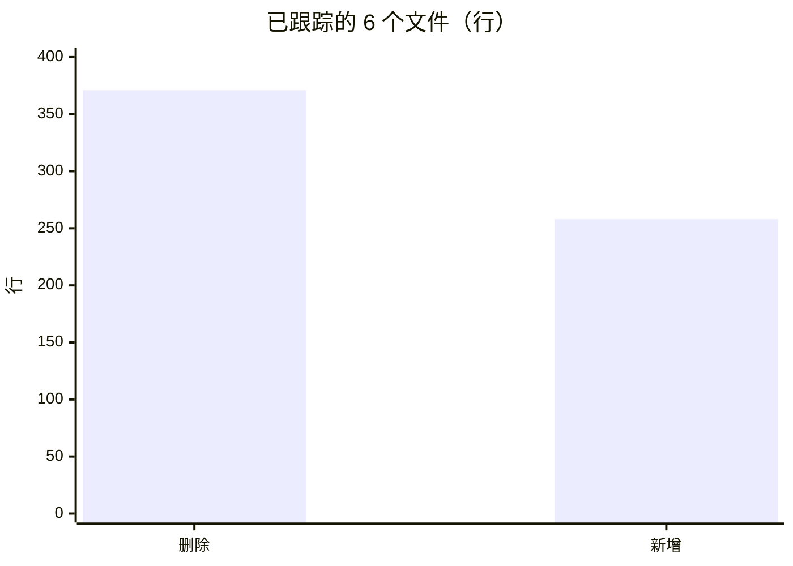

# 文档技能写法

- 日期：2026-10-30
- 分支：main（skill 改动在 030b726，这份说明没有进入该提交）
- 范围：改了 commit-report 和 intern-daily-report 的写法。Humanizer-zh 本身没改。

## 问题

commit-report 的两份模板按长章节铺开，数字主要靠表。intern-daily-report 除了日报，还会写周报和单独的明日 TODO。两处都没有要求对照 Humanizer-zh。

本轮没动其他 skill，也没改 Humanizer-zh 的规则正文。

## commit-report

`commit-report/SKILL.md`：提交时仍写详细版和工作汇报，放在 `docs/changes/YYYY-MM-DD/`。写之前要读 `references/charts.md` 和 Humanizer-zh 的约束。没跑的验证写「未执行」。

`commit-report/references/charts.md`：新建。同一单位、不超过 4 个指标时，每个指标一张 mermaid `xychart-beta`。百分比的 y 轴固定 `0 --> 100`。行为分支用 `flowchart`。通过 / 失败 / 报错用三行表，因为失败条数通常小很多，画成条形会被压没。

`commit-report/references/template-report.md`、`commit-report/references/template-detailed.md`：按这个规则改了骨架。详细版仍保留测试命令和原始摘要。

## intern-daily-report

`intern-daily-report/SKILL.md`：只写日报。用户要周报或单独的明日 TODO 时，说明不写，然后只交日报。材料里已有的下一步，收在对应条目末尾。

`intern-daily-report/references/style_guide.md`：留着 `### N`、`N.M`、`●`，以及原来的日报样本。周报和明日 TODO 的格式删了。句式清单收成这段样本，避免按模板填空。

`intern-daily-report/assets/daily_template.md`：只剩个人日报和团队简版。

## 测试改动

没有改测试，也没有新增用例。这两个 skill 是 Markdown 说明，仓库里没有对应的测试命令。`sdflow-init/tests/dom/package.json` 与这次无关，没有跑。

## 验证

未执行：全量回归。没有可跑的命令。

已核对的 diff（`git diff --stat HEAD`，不含未跟踪的 `charts.md`）：6 个文件，删除 371 行，新增 258 行。

`charts.md` 是新文件，不在这张图里。

## 回滚

- 两个 skill 一起撤回：`git revert` 这次提交，文档模板和日报范围一起回到上一版。
