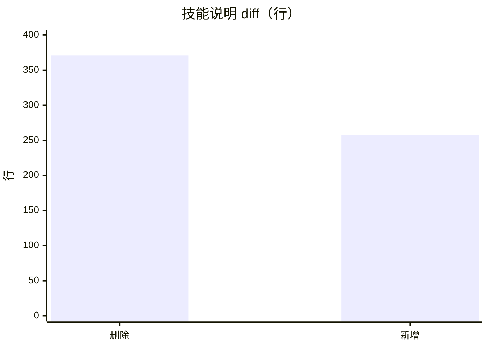

# 两份写文档的技能收短了

- 日期：2026-10-30
- 分支：main（skill 改动在 030b726）
- 范围：一次提交。commit-report 改成用图表示对比；实习日报只保留当天的日报。这份说明没有进入该提交。

## 结论

提交说明和工作汇报改成先写结论，对比用条形图，正文不再按长章节把同一组数字讲两遍。实习日报只写当天，周报和单独的明日清单从技能里拿掉了。两处写句子之前都要按 Humanizer-zh 检查，不补材料里没有的数字。

技能说明本身的 diff：已跟踪的 6 个文件删了 371 行、新增 258 行。另有一份新的图规则，不在这张图里。

下游不用配合。已经写好的旧日报、旧汇报不会被改写。

## 改动

### 提交时的两份说明

以前数字主要放在表里，章节按「问题、做法、测试、没变、回退」铺开。现在同一单位的改前改后，每个指标一张条形图；百分比的纵轴从 0 到 100，避免较小的比例被画成满格。调用关系变了才画流程图。测试的通过、失败、报错仍用表，失败往往比通过少很多，画成图会看不见。

### 实习日报

日报的标题和编号没变。周报、单独的明日 TODO 不再生成。笔记里如果写了下一步，收在当天那条的末尾。实验对比继续用表。

## 测试

未执行：全量回归。这两个技能是说明文字，仓库里没有对应的测试命令。

| 新增或改过的验证 | 条数 | 在查什么 |
|---|---|---|
| 无 | 0 | 这次没有加测试 |

未执行：对照实验。未执行：真实调用抽检。上面的图来自 `git diff --stat`，不是运行结果。

## 边界和回退

| 项目 | 情况 |
|---|---|
| 下游 / 平台 | 不用改。触发词仍是提交代码、写日报 |
| 产物格式 | 汇报多了 mermaid 图。日报少了周报和明日清单两节 |
| 已有数据 | 旧文档不改，不用重跑 |
| 调用次数或额度 | 没变 |

退回这一次提交，两份技能一起回到上一版。
