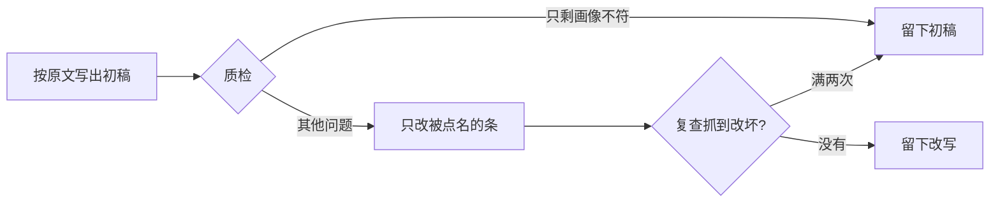

# markdown 图表兼容写法

## 何时使用

- 在 md 报告、方案、汇报里加流程图或数据图。
- 文档要复制到不确定版本的 markdown 编辑器、wiki、内部平台、老版 mermaid。
- 用户反馈"图显示不出来""只显示一段 flowchart 源码""mermaid 不渲染"。

## 三条硬规则

1. **只用 `graph`，不用 `flowchart`。** `graph` 在 mermaid 7.1 到 12 全部可用，`flowchart` 在 8.4 及以下直接报错。
2. **图内每行顶格。** 行首空格会被某些编辑器改写成 `&#160;`，新版 mermaid 直接卡死，整张图变成一段源码。
3. **标签里不出现危险字符。** 只用中文、英文、数字、空格，以及 `? ! . , : - + = / %`。不用引号、括号、全角标点、`①` `≥` `×`、`;` `~` `@`、`<br/>`。

安全写法样例（可直接套）：



每条规则背后的版本证据见 [references/compat-matrix.md](references/compat-matrix.md)，改法对照见 [references/conversion-recipes.md](references/conversion-recipes.md)。

## 文档默认对外可发

图能渲染只是最低要求。这类 md 的默认假设是**写出来就能直接转发**给同事、主管或外部，不需要作者再改一遍措辞。落笔时按交付件写，不按草稿写。

### 标题与列名用陈述式

| 草稿式 | 交付式 |
|---|---|
| `## 8. Rubric：12 维怎么来的` | `## 8. Rubric：12 维的归纳过程` |
| `### 7.3 批评长什么样` | `### 7.3 批评的字段与写作约束` |
| `### 7.4 为什么这样能学到东西` | `### 7.4 学习信号的来源` |
| `## 1. 问题：为什么"记得"不等于"会用"` | `## 1. 问题界定：记忆的可用性与决策转化` |
| `\| 段 \| 做什么 \|` | `\| 段 \| 职责 \|` |
| `\| 角色 \| 参数 \| 看到什么 \|` | `\| 角色 \| 参数 \| 可见输入 \|` |

标题写成"名词短语 + 冒号 + 名词短语"，去掉标题后整篇目录仍然读得通。不写设问，不出现"怎么、为什么、是什么、长什么样"，不用感叹号。

### 正文不写口语

- 不用"其实、反正、说白了、大概率、搞一下、弄一个、我觉得、我们"。
- 不用设问与自问自答（"那怎么办？"），直接给结论再给理由。
- 不写过程性废话（"下面我们来看…""接下来介绍…"），章节直接从内容开始。
- 不留草稿痕迹：TODO、"待补充"、"（这里还能再补）"、重复空行。
- 数字保留原始精度，并写清口径差异，不要四舍五入到看不出区别。

### 交付前搜一遍

```bash
grep -nE '[？！?]|为什么|怎么|什么|吗|呢|其实|反正|大概率|一下|我们' 文档.md
```

命中项逐条判断：引用原文对白、用户提问原文可以保留，标题与自述文字一律改写。

## 写图流程

1. **先判断要不要图。** 三五个框、一条链、两层判断 → 用图；只是罗列或对比 → 用表格或列表，比图更耐折腾。
2. **只用这四种图表类型**：`graph`、`sequenceDiagram`、`classDiagram`、`gantt`。其他类型按下面的替代方案处理。
3. **一个节点只说一件事。** 换行、补充说明、公式细节都不要塞进节点，放到图下面的列表里。节点文字控制在 20 字内，超过就拆节点。
4. **判断条件写成菱形**：`B{单轮分达到 0.45?}`，两个分支用 `B -->|是|`、`B -->|否|`。
5. **写完跑自检脚本**，清掉所有 ERROR。
6. **把细节补在图下面。** 兼容写法会牺牲图内的排版层次，用"图 + 图下列表"补回来，信息不能因为兼容而丢。

## 数据图替代方案

| 原来想用 | 改成 | 要点 |
|---|---|---|
| `xychart-beta` 柱状图 | 表格 + `█` 条形 | 标题写"条长从 X 起算，每格 Y"；起算值取全表最小值向下取整，否则柱高差异被压平 |
| `quadrantChart` 象限图 | 两行两列表 | 列是横轴，行是纵轴，格子写结论 |
| `mindmap` 思维导图 | 嵌套列表 | 三级以内，不要超过四层 |
| `timeline` 时间线 | 表格（时间 / 事件） | — |
| `pie` 饼图 | 表格 + 百分比列 | 老版本要 mermaid 8.4 才支持，能不用就不用 |

条形表格样例：

**PersonaGym 平均分（1-5 分，条长从 4.0 起算，每格 0.05）**

| 模型 | 平均分 | 图示 |
|---|---|---|
| SFT | 4.58 | ████████████ |
| **MOA** | **4.75** | **███████████████** |
| GPT-4o | 4.85 | █████████████████ |

## 自检

改完或写完，对每个文档跑一次：

```bash
python <skill目录>/scripts/check_md_diagram.py 文档.md
```

- **ERROR 必须全部清掉**：`flowchart`、行首缩进、危险字符、新版图表类型、条形长度对不上。
- **WARN 视目标环境处理**：引号、`<br/>`、`style`、`subgraph`、`&` 并列、`pie` 等。目标是"任意环境"就一起清掉；已确认对方是现代 mermaid 的可以留。
- 脚本退出码 0 表示没有 ERROR。多个文件可以一次传入。

## 复制到外部网站前

- 图内已经顶格、无引号，一般能直接贴；贴完先刷新一次页面再看图，有些平台需要刷新才渲染。
- 粘贴后如果看到 `&#160;`、`&quot;`、`&lt;` 这类字样，说明平台在转义，把对应的空格或引号去掉重贴。
- 本地相对路径的图片（``）不会跟着复制过去，先上传图片再改链接。
- `<details>` 折叠块、HTML 标签在老平台可能被当普通文字显示，发布前确认；不确定就改成小标题加列表。

## 资源

- `scripts/check_md_diagram.py`：唯一的检查工具，纯标准库，Windows/Linux/macOS 都能跑，不需要装 mermaid 或 node。
- `references/compat-matrix.md`：mermaid 7.1/8.0/8.4/8.6/8.8/8.13/9.1/10.9/12 的逐项实测结果，含编辑器把缩进改成 `&#160;` 的实测记录。
- `references/conversion-recipes.md`：流程图、柱状图、象限图、思维导图的逐条改法对照。
