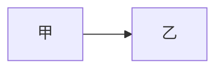
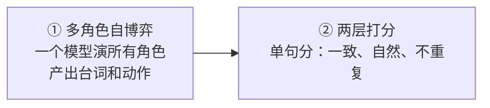
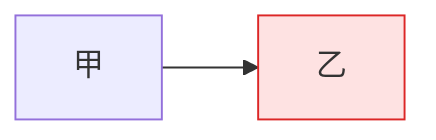
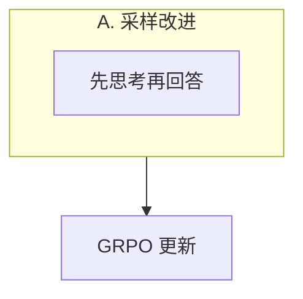
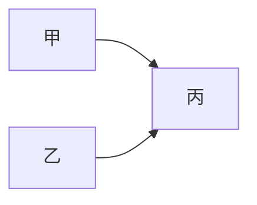
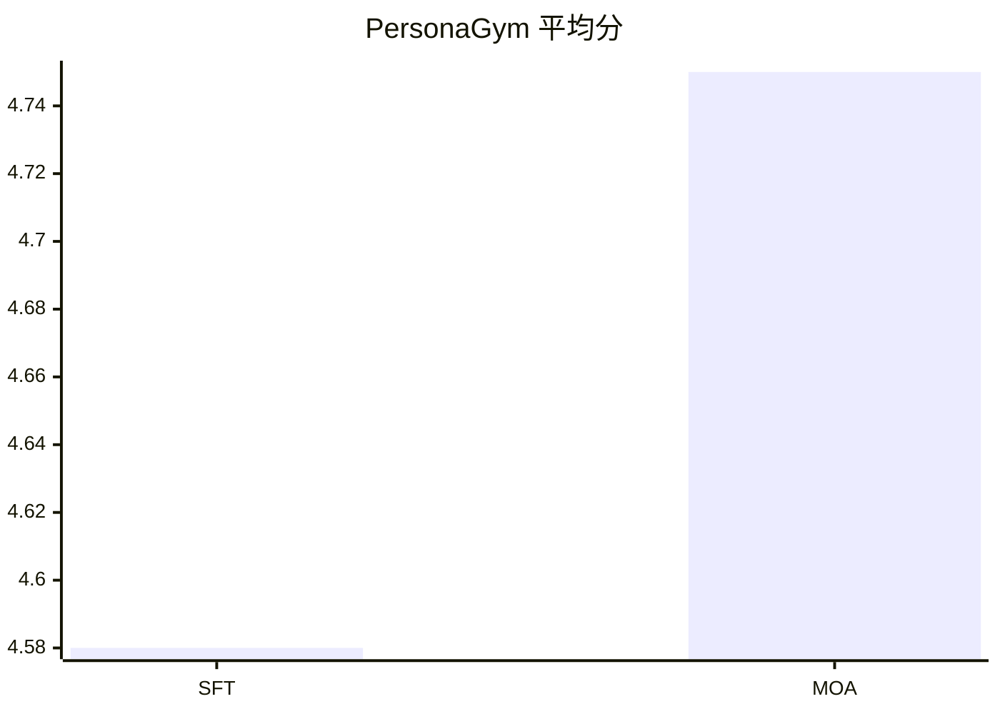

# 改法对照

每条都是"老环境显示不出来"或"可能显示不出来"的写法，改法是实测过的。改完逐条保留原意，不要为了兼容丢信息：图里放不下的，放到图下面的列表或表里。

注意：本文的"不推荐"示例故意保留错误写法，不要拿 `check_md_diagram.py` 检查这个文件，报错是预期的。

## 1. 流程图

### 1.1 关键字

改成：

### 1.2 缩进

改成（每行顶格）：

### 1.3 引号 + 中文标点 + ` `

不推荐：

推荐（一行说一件事，细节挪到图下）：

在图下面补：

- **① 多角色自博弈**：一个模型演所有角色，产出台词和动作。
- **② 两层打分**：单句分看一致、自然、不重复；整场分看人设、连贯、互动丰富。

### 1.4 `style` 上色

不推荐：

改成：删掉 `style`，用表格的加粗或"重点"一列表达。要保留颜色就改用普通表格。

### 1.5 `subgraph` 分组

不推荐：

改成（组名写进节点）：

组里有多条时，每个节点前面都带上组名，组的概念由"名称前缀 + 图下列表"表达。

### 1.6 `&` 并列

不推荐：`A[甲] & B[乙] --> C[丙]`
改成两行：

### 1.7 带编号的节点（①②③）

`①` 在老版本里直接报错。改成图下列表的编号，或写成 `1` `2` `3`（半角数字和空格都安全）。

## 2. 柱状图：`xychart-beta` → 表格加 █

不推荐：

改成：

**PersonaGym 平均分（1-5 分，条长从 4.0 起算，每格 0.05）**

| 模型 | 平均分 | 图示 |
|---|---|---|
| SFT | 4.58 | ████████████ |
| **MOA** | **4.75** | **███████████████** |

换算规则：

- 格数 = (分数 − 起算值) ÷ 每格，四舍五入，最少 1 格。
- 起算值取全表最小值再往下取整到刻度（如全表 4.34~4.85，起算 4.0）；这样差异才看得出来。若从 0 起算，柱高差异会被压平。
- 每格取 (最大值 − 起算值) ÷ 15 左右，最长一条 15~25 格，另外确保最小值至少 3 格可见。
- 标题里必须写清"从 X 起算，每格 Y"，脚本会用这行核对每一条的长度。
- 条长超过 25 格时表格会被撑宽，缩小每格或缩短标签。

## 3. 象限图：`quadrantChart` → 两行两列表

把象限图直接改成表格，列是横轴、行是纵轴：

| | 单轮回复 | 多角色长剧情 |
|---|---|---|
| **多条标准互相冲突** | MOA 的主场 | 两者叠加（未验证） |
| **评分标准单一** | 常规 SFT/DPO 即可 | LSH-RL 的主场 |

## 4. 思维导图 / 时间线

`mindmap` 改嵌套列表：

- 主题
  - 分支一
    - 细节
  - 分支二

`timeline` 改成两列表（时间 / 事件）。

## 5. `sequenceDiagram` 和 `gantt`

这两个从 7.1 起就支持，可以放心用。注意两点：

- 参与者和消息文字用中文没问题；消息里的中文标点实测也能解析，但换成空格最稳。
- 不要在消息里用 `;`，老版本的词法器会把它当语句分隔。

## 6. 改完做什么

1. 跑 `python scripts/check_md_diagram.py <文件>`，把 ERROR 全部清掉。
2. WARN 逐条看：目标是"任意环境"时也清掉；已确认对方是现代 mermaid 的，可以留。
3. 图里的信息没有因为兼容而丢失：删掉的细节都进了图下面的列表或表。
